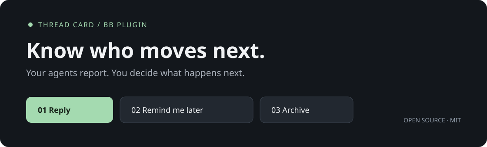

# Thread card for bb

**Know which agent needs you, and what to do next.**

Thread card adds a **Needs you** queue to [bb](https://getbb.app). Each card tells you what a thread is about, what the agent finished, and who needs to take the next step. Reply, leave it for later, or archive the thread.

[Install](#install) · [How it works](#how-it-works) · [Settings](#settings) · [CLI](#cli) · [Contributing](#contributing)



## One queue for your next move

| Action | What happens |
| --- | --- |
| **Reply** | Opens the conversation beside the queue. On a phone, opens the chat with a **Back to list** button. You send the answer yourself. |
| **Remind me later…** | Moves the current request to **Snoozed** until the time you choose. A new request from the same thread can bring it back sooner. |
| **Archive** | Archives the thread through bb. You can restore it from the archive. Threads with children get a confirmation. |

The `…` menu holds **Pin**, **Hide this item**, and **Open full thread**. Hiding a card leaves the thread in place; a new request appears again. Neither hiding nor snoozing sends an answer or pauses the agent.

Four views keep different kinds of waiting apart:

- **Needs you** — a question, approval, or action for you.
- **Waiting** — someone else, another thread, or a scheduled event has the next step.
- **Stopped** — failed, interrupted, or stopped work, and statuses the plugin could not establish.
- **Snoozed** — requests you set aside until a chosen time.

Group by **section** or **project**, filter by either, and search titles and requests. Sections are the default: a section appears once even when it contains threads from several projects. The choice stays separate from your sidebar layout.

The queue holds its place while you read. New requests collect behind **Show N updates** instead of moving cards under your pointer.

## Install

Requires **bb 0.43 or newer**, with Plugin SDK **0.5.9 or newer**. The current release was checked on bb **0.43.4**. The helper's filesystem setup targets Linux and macOS; Windows has not been validated.

In a terminal where bb's CLI is available:

```sh
bb plugin install 'git:https://github.com/merllinsbeard/bb-thread-card.git@^0.6.3'
```

Review bb's trust prompt: plugins run with full access. Then open **Needs you** in the sidebar. The thread header also has a **Thread card** button for the current thread's details and title controls.

```sh
# Pick up compatible releases later
bb plugin update thread-card
```

**Start with the defaults.** Status tracking and agent reports work with automatic helper checks off. Newly started agent sessions receive the reporting tool; an already open provider session may need to restart before the tool appears.

## How it works

The working agent calls `report_thread_status` at the end of its turn. It supplies a stable topic, a short progress summary, and the next step. The plugin combines that report with bb's actual execution state: an active run, a pending approval, a provider error, or a stopped turn.

| Status | Who moves next? |
| --- | --- |
| Working | The agent is running or has work that will resume automatically. |
| Needs you | You need to answer, decide, sign in, approve, or do something the agent cannot. |
| Waiting | Another person, service, CI run, or thread. |
| Done | No work remains in the agreed scope. |
| Unknown / checking | The plugin does not yet have enough evidence. |

Statuses appear on sidebar rows and in the thread card. Your manually chosen titles keep their wording. You can lock a title or restore the title that existed before the plugin changed it.

### Optional helper

If an agent finishes without reporting, an optional helper can read the conversation and fill in the card. Automatic helpers and title updates are **off by default**. Manual **Recheck card** and `bb thread-card refresh` can also start a helper.

Before enabling helpers, choose a provider and model available in your bb installation and create the dedicated directory on the primary execution host:

```sh
bb provider list
bb provider models codex
bb plugin config thread-card

# Substitute a model ID from your provider's catalog
bb plugin config thread-card set providerId codex
bb plugin config thread-card set model YOUR_MODEL_ID
bb plugin config thread-card set reasoningLevel low
mkdir -p "$HOME/.local/share/bb-thread-card/helper"
bb plugin config thread-card set enabled true
```

Helpers use your configured provider and consume its tokens or subscription allowance. There is no separate Thread card subscription. Report-based tracking does not start additional model sessions.

Each helper runs as a hidden bb thread in a dedicated workspace on the primary execution host and is deleted after use. If the server and primary host have different home directories, set `helperWorkspace` to an absolute path on that host and create it there. Keep that workspace empty and outside your projects. Exclude it from any memory-capture hooks you have installed: the helper receives a copy of another thread's conversation.

## Settings

Open the plugin's settings in bb, or use `bb plugin config thread-card`.

| Key | Default | Purpose |
| --- | --- | --- |
| `enabled` | `false` | Automatic title updates and helper checks. Status tracking stays on. |
| `statusDisplay` | `row` | Sidebar icon; choose `title` for an emoji before the title. |
| `idleMinutes` | `15` | Quiet time before checking a turn whose agent did not report. |
| `minIntervalMinutes` | `10` | Minimum interval between helper checks for one thread. |
| `skipSections` | empty | Comma-separated section names or IDs to leave alone entirely. |
| `providerId` | `codex` | Provider used for helper sessions. |
| `model` | `gpt-6-luna` | Helper model. Change this if it is absent from your catalog. |
| `reasoningLevel` | `max` | Helper reasoning effort; choose an effort your model supports. |
| `workers` | `2` | Maximum concurrent helpers. |
| `cleanupSessions` | `true` | Remove helper session files for Claude Code and Codex. |
| `helperWorkspace` | `~/.local/share/bb-thread-card/helper` | Dedicated helper directory, resolved from the bb server user's home. |

The interface and CLI are in English. Agent summaries and titles follow the conversation's language. Internal reporting prompts currently use Russian; they instruct the helper to answer in the owner's language.

## CLI

The same queue is available to agents and terminal users:

```sh
bb thread-card queue --view needs --json
bb thread-card status THREAD_ID
bb thread-card show THREAD_ID

bb thread-card snooze THREAD_ID --for 1h
bb thread-card dismiss THREAD_ID
bb thread-card restore THREAD_ID

bb thread-card lock THREAD_ID
bb thread-card unlock THREAD_ID
bb thread-card revert THREAD_ID

bb thread-card stats
bb thread-card list --project PROJECT_ID --json
```

Run `bb thread-card <command> --help` for exact options. Inside a bb thread, `show`, `status`, and title commands can use the current thread when the ID is omitted.

Snooze, dismiss, and restore operate on a version of a request. For automation, pass the `requestId` and `version` returned by the queue using the command's corresponding options. A stale action cannot hide a newer question.

`bb thread-card refresh THREAD_ID --dry-run` previews a helper-generated card without applying it. **It still runs the model.**

## Data and limits

Cards, title history, and request dispositions use bb's server-side plugin storage. Queue layout and filter preferences live in the browser's local storage. The plugin has no separate hosted backend. Agent reports stay in bb; helpers send the selected conversation material through the provider you configured, under that provider's terms.

Session cleanup applies to helper sessions in the bb server user's default `~/.claude` and `~/.codex` directories. Helpers on a remote execution host or using custom provider home directories can retain their transcripts even with `cleanupSessions=true`. Other providers and external memory hooks also manage their own copies; Thread card does not clean those stores.

Child threads, hidden threads, and plugin-created threads are excluded from the owner's queue. A parent can report which child threads it is waiting for.

**By status** sidebar sorting is registered only when bb exposes the optional plugin sorting API. Stock bb 0.43.4 does not expose it. The queue, cards, and row indicators work without it.

## Contributing

Use **Node.js 24**, npm, and the bb CLI. Start from the release tag or the current development PR until it lands in `main`.

```sh
git clone https://github.com/merllinsbeard/bb-thread-card.git
cd bb-thread-card
git switch --detach v0.6.3
npm ci
npm run typecheck
npm test
bb plugin build .
```

Create a feature branch before making changes. To preview a plugin in a development bb installation, use `bb plugin dev .`. Keep development away from a bb instance running work you cannot interrupt.

- `server.ts` wires settings, RPC, CLI, events, and the collector.
- `lib/` holds status derivation, request versions, title policy, helper sessions, and storage.
- `ui/` holds the queue, thread card, sidebar indicators, and shared controls.
- `test/` covers behavior through pure functions, recorded event fixtures, and the SDK's fake host. These are automated tests, not live provider calls.

For UI changes, also check the running plugin at desktop and phone widths. A good bug report names the bb and plugin versions, the action taken, expected behavior, and a redacted error or screenshot. Please remove conversation text and credentials before posting.

## License and credits

[MIT](LICENSE). Built by [merllinsbeard](https://github.com/merllinsbeard).

Includes code adapted from [bb-plugin-retitle](https://github.com/chug2k/bb-plugin-retitle) and [bb-recap](https://github.com/MacHatter1/bb-recap). Their licenses and attributions are preserved in [NOTICE](NOTICE).
